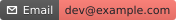

# readmefetch

Your GitHub profile README as an animated, neofetch-style terminal.

<p align="center"></p>

<p align="center">
<a href="https://example.com"></a>
<a href="mailto:dev@example.com"></a>
<a href="https://example.com/blog"></a>
<a href="https://example.com/games"></a>
<a href="https://example.com/sponsor"></a>
<a href="https://github.com/aurelioochoa/readmefetch"></a>
</p>

When someone opens your profile, `readmefetch` types itself at the prompt and the output
types itself in, each line at its own speed. Then the logos take turns: a drone flies in
with spinning rotors, Tux blinks, a cauldron boils, a computer types a shell session,
and the info keys change colour to match each logo. The cursor keeps blinking.

It's a single SVG with CSS animations, which GitHub plays in READMEs. It has no
scripts and loads no fonts. Info lines can show live GitHub numbers, a contribution
graph or heatmap, a language bar and icons for your tools. The window can look like
macOS, Mac OS X, classic Mac OS or Windows 95 to 11. readmefetch can also print the
same thing in your terminal, export it as a GIF, and make matching badges for your
links (above). A local web editor shows every setting with a live preview.

## Quick start

```sh
pipx install git+https://github.com/aurelioochoa/readmefetch   # or: pip install git+https://...
readmefetch init --github YOUR_USERNAME   # writes readmefetch.toml from your public profile
readmefetch print                         # preview in the terminal
readmefetch render                        # writes readmefetch.svg (and your badges)
readmefetch web --open                    # or edit everything in the browser
readmefetch icons python                  # find icons for your info lines and badges
readmefetch windows                       # list the window styles
```

Put the SVG in your profile README (the repository named after your username):

```html

```

Python 3.11 or newer is required. There are no other dependencies, except for GIF export.

## Keep it fresh with GitHub Actions

Live numbers (`{repos}`, `{stars}`, `{followers}`, `{contributions}`) and `{uptime}`
change over time. Add `.github/workflows/readmefetch.yml` to your profile repository:

```yaml
name: readmefetch
on:
  schedule: [{ cron: "0 4 * * *" }]   # daily
  workflow_dispatch:
  push: { paths: [readmefetch.toml] }
permissions:
  contents: write
jobs:
  render:
    runs-on: ubuntu-latest
    steps:
      - uses: actions/checkout@v4
      - uses: aurelioochoa/readmefetch@v1
        # with:
        #   config: readmefetch.toml
        #   gif: "true"        # also export readmefetch.gif
```

The action renders the image and your badges, and commits them only when they changed.

## GIF export

```sh
pip install "readmefetch[gif] @ git+https://github.com/aurelioochoa/readmefetch"
readmefetch gif                  # readmefetch.gif
readmefetch gif --no-intro       # skip the typing so the loop is seamless
readmefetch gif --fps 12 --scale 2 --frames frames/   # smoother, sharper, keep the PNGs
```

GIF export renders the real SVG in headless Chrome, Chromium, Brave or Edge, so the GIF
matches what GitHub shows. It pauses every animation and seeks it to each frame's exact
time, so the frames are deterministic. Set `READMEFETCH_BROWSER` if your browser isn't
found automatically. GitHub's Ubuntu runners already have Chrome. GIF export works on
Linux and macOS.

## The web editor

```sh
readmefetch web --open                 # edits ./readmefetch.toml on http://127.0.0.1:8765
readmefetch web -c path/to/readmefetch.toml --port 0   # any free port
make web                               # the same, from a checkout
```

A small local app in GitHub's look: every setting, with the README preview updating as
you type, light and dark pages, a Replay button for the intro and an actual-size view.
It has a logo picker with thumbnails, one-click GitHub lines, a searchable icon picker,
window styles with their matching presets, a badge builder with a gallery of every
style, and a **Draw** tab for your own logo. You can type or paint
in colour, add frames, paste ASCII art or start from a built-in logo. Then
download the SVG, the config, a GIF or the README and workflow snippets. **Save**
writes the config (the old one is kept as `readmefetch.toml.bak`), the SVG and the badges.

The server uses only Python's standard library and listens on 127.0.0.1. It refuses
requests from other sites, and other hosts can't reach it.

## Configuration

`readmefetch init` writes a commented `readmefetch.toml`. Every setting:

| Setting | Default | |
| --- | --- | --- |
| `user`, `host` | `"user"`, `"github"` | shown as `user@host` in the prompt, title bar and info header |
| `cwd` | `"~"` | the directory in the prompt and title bar |
| `command` | `"readmefetch"` | what gets typed |
| `theme` | `"github-dark"` | `github-dark`, `github-light`, `dracula`, `tokyo-night`, `catppuccin-mocha`, `gruvbox-dark`, `nord`, and the classic terminals `terminal-basic`, `terminal-pro`, `classic-mac`, `campbell`, `powershell`, `cmd` (`readmefetch themes`) |
| `logos` | `["tux"]` | logos shown in turn; `readmefetch logos` lists them |
| `seconds_per_logo` | `5` | how long each logo stays |
| `info` | `[]` | the lines on the right (see below) |
| `uptime_since` | none | date for `{uptime}`, e.g. `2021-05-01` |
| `github` | none | username for the live numbers and graphs |
| `color_blocks` | `true` | the two rows of colour swatches |
| `initials` | first letters of `user` and `host` | printed on the drone's camera |
| `output` | `"readmefetch.svg"` | relative to the config file |
| `[colors]` | | override theme colours: `accent`, `bg`, `fg`, `dim`, `red`, `bright-blue`, ... |
| `[banner]` | | `text` (default `user`), `font` (`standard`, `slant`, `small`, `smslant`, `big`, `tubes`), `colors` (list), `wave` (`true`) |
| `[intro]` | | how the output appears on a visit (see below) |
| `[cursor]` | | `style` (`block`, `bar`, `underline`), `blink` (`true`), `period` (`1.1` s), `color` (`"fg"`) |
| `[prompt]` | | `format` (`"{user}@{host}:{cwd}$ "`), `user_color` (`"green"`), `cwd_color` (`"blue"`) |
| `[window]` | | `style` (`"macos"`, see [Window styles](#window-styles)), `title` (`"{user}@{host}: {cwd}"`, `""` for none), `buttons` (`true`) |
| `[metrics]` | | the GitHub graphs: `weeks` (`26`), `languages` (`4`), `bar_width` (`30`), `colors` (5 colours), `exclude` (languages to leave out) |
| `[logo.NAME]` | | a custom logo, or settings for a built-in one (see below) |
| `[badges]`, `[[badge]]` | | badges for your links (see below) |

**The intro** runs once, when someone opens the page:

```toml
[intro]
scope = "all"              # none: lines fade in · info: the info types in · all: the logo too
direction = "left-to-right"  # right-to-left, top-to-bottom, bottom-to-top
# speed = 50               # cells per second (default 50 across, 24 down)
variance = 0.5             # each line runs at speed × (1 ± variance), so they finish at different times
# stagger = 0.08           # seconds between one line starting and the next
seed = 1                   # change it to shuffle the speeds
command_speed = 12.5       # characters per second for the command
```

With `scope = "all"` the first logo is typed in, so it skips its usual entrance once.

**Info lines.** `"Key: value"` prints the key in the logo's colour, a line without a
`Key: ` prefix prints as plain text, and `""` leaves a blank line. `{user}`, `{host}`,
`{cwd}`, `{uptime}` and `{year}` always work; the GitHub ones are below. `:name:` draws
an icon (see [Icons](#icons)). Write `{{` and `}}` for literal braces.

**Colours** are theme names (`red`, `bright-green`, `accent`, `fg`, `dim`, ...) or `#rrggbb`.

### GitHub numbers and graphs

Set `github = "your-username"` and use these in info lines (and in badges, see below):

| Placeholder | | Token |
| --- | --- | --- |
| `{repos}`, `{stars}`, `{forks}` | public repositories, and the stars and forks of the ones you own (not your forks) | |
| `{followers}`, `{following}`, `{gists}`, `{joined}` | from your profile; `{joined}` is the year | |
| `{prs}`, `{issues}` | pull requests and issues you opened | |
| `{contributions}`, `{commits}`, `{reviews}` | in the last year, as on your profile | yes |
| `{streak}`, `{longest_streak}` | days in a row with a contribution | yes |
| `{top_language}` | your most-used language | |
| `{graph}` | the contribution calendar as one line of bars, a week per bar | yes |
| `{heatmap}` | the calendar as squares, four lines tall (keep it on a line of its own) | yes |
| `{langbar}` | a bar split by language, in GitHub's language colours | |
| `{languages}` | a legend: `● Python 46%  ● TypeScript 27%  …` | |

Numbers get thousands separators (`1,234`). "Token" means the GraphQL API: the Action
passes one, and locally `GITHUB_TOKEN`, `GH_TOKEN` or `gh auth login` work. Without a
token those numbers show `?`, the graphs are empty, and the language mix is estimated
from each repository's main language. `--offline` (and the web editor with **Live GitHub data** off) uses zeros and
made-up graphs, so you can see the layout.

```toml
info = [
  ":repo: Repos: {repos} · :star: {stars}",
  "Activity: {graph}",
  "{heatmap}",
  "Languages: {langbar}",
  "{languages}",
]

[metrics]
weeks = 26                 # how much of the calendar {graph} and {heatmap} show (4 to 53)
languages = 4              # how many {languages} lists; the rest are "Other"
bar_width = 30             # {langbar}'s width in characters
# colors = ["#161b22", "#0e4429", "#006d32", "#26a641", "#39d353"]  # empty, then 4 levels
# exclude = ["HTML", "Jupyter Notebook"]
```

The graphs are drawn shapes, not text, so they line up in any font. `readmefetch print`
draws them with block characters.

### Icons

`:name:` in an info line (or a badge's `icon`) draws an icon. About 500 are included:
GitHub's [Octicons](https://primer.style/octicons) (`:repo:`, `:star:`, `:git-pull-request:`,
`:flame:`, ...), brand logos from [Simple Icons](https://simpleicons.org) and
[Devicon](https://devicon.dev) (`:python:`, `:rust:`, `:docker:`, `:neovim:`, ...) and
Linux distributions and desktops from [font-logos](https://github.com/lukas-w/font-logos)
(`:archlinux:`, `:gnome:`, ...). Nerd Font names work too: `:nf-dev-python:`,
`:nf-oct-repo:`, `:nf-linux-archlinux:`.

```sh
readmefetch icons            # every icon, by set
readmefetch icons rust       # search
readmefetch print --nerd-font   # print them as Nerd Font glyphs in your terminal
```

They're drawn as SVG shapes in the text colour, so visitors see them without a Nerd
Font. An unknown `:nf-...:` name is an error; other `:words:` (like `12:30:45`) stay text.
Brand logos are their owners' trademarks; see [CREDITS.md](CREDITS.md#icons).

### Window styles

```toml
[window]
style = "win95"
```

| Style | |
| --- | --- |
| `macos` | traffic lights and a centred title (the default) |
| `tahoe` | macOS Tahoe 26: Liquid Glass, rounder and lighter |
| `aqua` | Mac OS X: glossy gel buttons on pinstripes |
| `platinum` | Mac OS 9: a ridged grey title bar |
| `system7` | System 7: black-and-white stripes |
| `win11` | Windows 11: a Mica bar with its controls on the right |
| `win7` | Windows 7: Aero glass and a red close button |
| `winxp` | Windows XP: Luna's blue title bar |
| `win95` | Windows 95/98: grey bevels and a navy title bar |
| `none` | no frame |

A style changes only the frame. Each one also has a preset with the prompt, theme,
title and cursor of that system's own terminal (`readmefetch windows` lists them):
`win95` is `C:\WINDOWS>` on the `cmd` theme in an "MS-DOS Prompt" window. The web
editor's **Window** tab can apply just the prompt or the whole preset, with an Undo.

## Logos

`readmefetch logos` lists them and `readmefetch logos NAME` previews one with its credit.

- **Animated originals**: `drone` (flies in and sprays a crop field), `pot` (steam and
  flames), `tux` (blinks).
- **Candy Box 2 art**: `cauldron` by dixsept (it boils), `computer` by aniwey (a shell
  session types out on its screen).
- **Your name**: `banner` renders text in a FIGlet font with a rolling colour wave.
- **Operating systems**, from fastfetch/neofetch: `linux`, `arch`, `debian`, `ubuntu`,
  `fedora`, `macos`, `windows`, `nixos`, `raspbian`, `android`, `mint`, `pop`, `kali`,
  `gentoo`, `manjaro`, `freebsd`, `alpine`, `opensuse`.
- **Languages**, from onefetch: `python`, `javascript`, `typescript`, `php`, `java`, `lua`,
  `rust`, `go`, `html`, `css`, `sass`, `vue`, `c`, `cpp`, `csharp`, `ruby`, `kotlin`,
  `swift`, `dart`, `bash`, `docker`.

### Custom logos

Custom logos use fastfetch's colour syntax: `$1`..`$9` switch to that entry of `colors`,
and the colour stays on across lines. `$$` is a literal `$`. Use `'''` strings so
backslashes stay as they are.

```toml
logos = ["mine", "tux"]

[logo.mine]
colors = ["bright-cyan", "#ff8800"]
art = '''
$1   /\
$1  /  \   $2hi!
$1 /____\
'''
enter = "print"        # print (line by line), fly (in from the top), fade
hover = false          # gentle bobbing
accent = "bright-cyan" # info-key colour while this logo shows
credit = "art by ..."  # kept in the SVG

[[logo.mine.layers]]   # optional animated parts, drawn over the art
row = 1
col = 9
period = 1.0           # seconds per cycle
frames = ["$2hi!", "$2yo!"]
weights = [3, 1]       # relative time each frame stays
```

A `[logo.NAME]` table without `art` adjusts a built-in logo instead:

```toml
[logo.tux]
enter = "fly"     # print, fly or fade
hover = true
accent = "bright-yellow"
animate = false   # a still Tux: no blinking
```

Where to find more art, and the terms that come with it, is in
[CREDITS.md](CREDITS.md#finding-more-art).

## Badges

Badges are small SVG buttons for your sites, projects and contact details. They match the
terminal, and you own the files. List them in the config:

```toml
[badges]                   # defaults for every badge
style = "for-the-badge"
dir = "assets/badges"      # relative to the config file

[[badge]]
label = "Portfolio"
message = "example.com"
link = "https://example.com"
color = "#00d4ff"          # a theme colour name or #hex
icon = "globe"

[[badge]]
label = "Email"
message = "me@example.com"
link = "mailto:me@example.com"
color = "red"
icon = "mail"
style = "terminal"         # per-badge style
```

```sh
readmefetch badges          # writes the SVGs and prints the README lines that show them
readmefetch badges --html   # the same lines as <a></a>, for inside <p align="center">
```

`readmefetch render` and the Action write them too.

- **Styles:**
  - **Classic:** `flat`, `flat-square`, `plastic`, `for-the-badge` and `pill` have the
    familiar badge shapes. `terminal` is a tiny prompt in your theme with a blinking cursor
    (it stays still for visitors who prefer reduced motion).
  - **Modern:** `outline`, `gradient`, `glow` and `glass`.
  - **GitHub:** `social` looks like GitHub's own buttons, with a counter: `Star | 128`.
  - **Window styles:** `macos`, `tahoe`, `aqua`, `platinum`, `system7`, `win11`, `win7`,
    `winxp` and `win95` match the [window styles](#window-styles), and `window` follows
    whichever one `[window] style` picks.

  `readmefetch badges --help` lists them, and the web editor's **Badges** tab shows a
  gallery of every style with your own text.
- **Live numbers:** `label` and `message` can use the GitHub numbers, like
  `message = "{stars}"` or `"{followers} followers"`. The Action keeps them current.
  The graphs (`{graph}`, `{heatmap}`, `{langbar}`, `{languages}`) only go in info lines.
- **Settings:** `label`, `message`, `link`, `color`, `label_color` (default grey),
  `icon`, `style`, `file` (default: from the label) and `cursor` (terminal style only).
- **Text:** it picks white or near-black, whichever reads better on the colour. Widths come
  from a Verdana width table and are pinned with `textLength`, so a badge keeps its shape
  whatever fonts the viewer has.
- **Icons:** `globe`, `mail`, `link`, `code`, `terminal`, `game`, `cards`, `tree`,
  `briefcase`, `heart`, `star`, `home`, `rocket` and `book` are readmefetch's own line
  drawings (MIT). Any name from [Icons](#icons) works too (`icon = "python"`), or paste the
  `d` attribute of your own 24×24 SVG path. Brand logos remain their owners' trademarks.

```toml
[[badge]]
label = "Stars"
message = "{stars}"
link = "https://github.com/you?tab=repositories"
icon = "star"
style = "social"
```

## How it works

GitHub serves README images through ``. In an ``, an SVG can run CSS
animations, but it can't run scripts or load web fonts. So readmefetch uses only CSS
keyframes:

- **Typing:** a mask slides off the command in steps.
- **Logos:** each one has a time slot in one cycle.
- **Frames:** fly-ins, printed reveals and frame-by-frame layers (rotors, flames,
  blinking eyes) are all opacity and transform changes.

- **Intro:** a cover the colour of the background sits over each line (or column) and
  shrinks away in steps of one character, so the text appears a cell at a time.

Every glyph gets its own x position on a character grid, so ASCII art stays aligned
whichever monospace font the viewer has. If the viewer has turned on reduced motion,
or the renderer doesn't animate, the SVG shows a finished, still frame.

## Development

```sh
make setup     # a .venv with readmefetch, Pillow and ruff
make check     # ruff, a syntax check of the web app's JS, and the tests
make web       # the web editor (CONFIG=path/to/readmefetch.toml, PORT=8765)
make demo      # regenerate examples/demo.svg, demo.gif and the example badges
make vendor    # refresh third-party art and icons from their pinned releases
make           # every target
```

The tests run without the venv too: `python -m unittest discover -s tests`. The GIF
test runs when Pillow and a browser are present.

## Credits and licence

The code is [MIT](LICENSE). Bundled art keeps its own licence: MIT (fastfetch,
neofetch, onefetch, Octicons, Devicon), BSD-3-Clause (FIGlet fonts), CC0 (Tubes font,
Simple Icons), the Unlicense (font-logos) and CC BY-SA 3.0 (Candy Box 2 art). [CREDITS.md](CREDITS.md) names every artist and licence and
lists what readmefetch changed in each piece.
