# readmefetch

Your GitHub profile README as an animated terminal running `neofetch`.

<p align="center"></p>

The command types itself out and the profile prints line by line. Logos take turns
beside it: a drone flies in with spinning rotors, Tux blinks, a cauldron boils, a
computer types a shell session, and the info keys change colour to match each logo.
After that, the cursor keeps blinking.

It's a single SVG with CSS animations, which GitHub plays in READMEs. It has no
scripts and loads no fonts. readmefetch can also print the same thing in your
terminal or export it as a GIF.

## Quick start

```sh
pipx install git+https://github.com/aurelioochoa/readmefetch   # or: pip install git+https://...
readmefetch init --github YOUR_USERNAME   # writes readmefetch.toml from your public profile
readmefetch print                         # preview in the terminal
readmefetch render                        # writes readmefetch.svg
```

Put the SVG in your profile README (the repository named after your username):

```html

```

Python 3.11 or newer is required. There are no other dependencies, except for GIF export.

## Keep it fresh with GitHub Actions

Live numbers (`{repos}`, `{stars}`, `{followers}`, `{contributions}`) and `{uptime}`
change over time. Add `.github/workflows/readmefetch.yml` to your profile repository:

```yaml
name: readmefetch
on:
  schedule: [{ cron: "0 4 * * *" }]   # daily
  workflow_dispatch:
  push: { paths: [readmefetch.toml] }
permissions:
  contents: write
jobs:
  render:
    runs-on: ubuntu-latest
    steps:
      - uses: actions/checkout@v4
      - uses: aurelioochoa/readmefetch@v1
        # with:
        #   config: readmefetch.toml
        #   gif: "true"        # also export readmefetch.gif
```

The action renders the image and commits it only when it changed.

## GIF export

```sh
pip install "readmefetch[gif] @ git+https://github.com/aurelioochoa/readmefetch"
readmefetch gif                  # readmefetch.gif
readmefetch gif --no-intro       # skip the typing so the loop is seamless
readmefetch gif --fps 12 --scale 2 --frames frames/   # smoother, sharper, keep the PNGs
```

GIF export renders the real SVG in headless Chrome, Chromium, Brave or Edge, so the GIF
matches what GitHub shows. It pauses every animation and seeks it to each frame's exact
time, so the frames are deterministic. Set `READMEFETCH_BROWSER` if your browser isn't
found automatically. GitHub's Ubuntu runners already have Chrome. GIF export works on
Linux and macOS.

## Configuration

`readmefetch init` writes a commented `readmefetch.toml`. Every setting:

| Setting | Default | |
| --- | --- | --- |
| `user`, `host` | `"user"`, `"github"` | shown as `user@host` in the prompt, title bar and info header |
| `command` | `"neofetch"` | what gets typed |
| `theme` | `"github-dark"` | `github-dark`, `github-light`, `dracula`, `tokyo-night`, `catppuccin-mocha`, `gruvbox-dark`, `nord` (`readmefetch themes`) |
| `logos` | `["tux"]` | logos shown in turn; `readmefetch logos` lists them |
| `seconds_per_logo` | `5` | how long each logo stays |
| `info` | `[]` | the lines on the right (see below) |
| `uptime_since` | none | date for `{uptime}`, e.g. `2021-05-01` |
| `github` | none | username for the live numbers |
| `color_blocks` | `true` | the two rows of colour swatches |
| `initials` | first letters of `user` and `host` | printed on the drone's camera |
| `output` | `"readmefetch.svg"` | relative to the config file |
| `[colors]` | | override theme colours: `accent`, `bg`, `fg`, `dim`, `red`, `bright-blue`, ... |
| `[banner]` | | `text` (default `user`), `font` (`standard`, `slant`, `small`, `smslant`, `big`, `tubes`), `colors` (list), `wave` (`true`) |
| `[logo.NAME]` | | a custom logo (see below) |

**Info lines.** `"Key: value"` prints the key in the logo's colour, a line without a
`Key: ` prefix prints as plain text, and `""` leaves a blank line. Placeholders:
`{uptime}`, `{repos}`, `{stars}`, `{followers}`, `{contributions}` (needs a token: the
Action passes one, and locally `GITHUB_TOKEN`, `GH_TOKEN` or `gh auth login` work),
`{user}`, `{host}` and `{year}`. Write `{{` and `}}` for literal braces.

**Colours** are theme names (`red`, `bright-green`, `accent`, `fg`, `dim`, ...) or `#rrggbb`.

## Logos

`readmefetch logos` lists them and `readmefetch logos NAME` previews one with its credit.

- **Animated originals**: `drone` (flies in and sprays a crop field), `pot` (steam and
  flames), `tux` (blinks).
- **Candy Box 2 art**: `cauldron` by dixsept (it boils), `computer` by aniwey (a shell
  session types out on its screen).
- **Your name**: `banner` renders text in a FIGlet font with a rolling colour wave.
- **Operating systems**, from fastfetch/neofetch: `linux`, `arch`, `debian`, `ubuntu`,
  `fedora`, `macos`, `windows`, `nixos`, `raspbian`, `android`, `mint`, `pop`, `kali`,
  `gentoo`, `manjaro`, `freebsd`, `alpine`, `opensuse`.
- **Languages**, from onefetch: `python`, `javascript`, `typescript`, `php`, `java`, `lua`,
  `rust`, `go`, `html`, `css`, `sass`, `vue`, `c`, `cpp`, `csharp`, `ruby`, `kotlin`,
  `swift`, `dart`, `bash`, `docker`.

### Custom logos

Custom logos use fastfetch's colour syntax: `$1`..`$9` switch to that entry of `colors`,
and the colour stays on across lines. `$$` is a literal `$`. Use `'''` strings so
backslashes stay as they are.

```toml
logos = ["mine", "tux"]

[logo.mine]
colors = ["bright-cyan", "#ff8800"]
art = '''
$1   /\
$1  /  \   $2hi!
$1 /____\
'''
enter = "print"        # print (line by line), fly (in from the top), fade
hover = false          # gentle bobbing
accent = "bright-cyan" # info-key colour while this logo shows
credit = "art by ..."  # kept in the SVG

[[logo.mine.layers]]   # optional animated parts, drawn over the art
row = 1
col = 9
period = 1.0           # seconds per cycle
frames = ["$2hi!", "$2yo!"]
weights = [3, 1]       # relative time each frame stays
```

Where to find more art, and the terms that come with it, is in
[CREDITS.md](CREDITS.md#finding-more-art).

## How it works

GitHub serves README images through ``. In an ``, an SVG can run CSS
animations, but it can't run scripts or load web fonts. So readmefetch uses only CSS
keyframes:

- **Typing:** a mask slides off the command in steps.
- **Logos:** each one has a time slot in one cycle.
- **Frames:** fly-ins, printed reveals and frame-by-frame layers (rotors, flames,
  blinking eyes) are all opacity and transform changes.

Every glyph gets its own x position on a character grid, so ASCII art stays aligned
whichever monospace font the viewer has. If the viewer has turned on reduced motion,
or the renderer doesn't animate, the SVG shows a finished, still frame.

## Development

```sh
python -m unittest discover -s tests -v   # the GIF test runs when Pillow and a browser are present
python tools/vendor_art.py                # refresh third-party art from its pinned commits
```

## Credits and licence

The code is [MIT](LICENSE). Bundled art keeps its own licence: MIT (fastfetch,
neofetch, onefetch), BSD-3-Clause (FIGlet fonts), CC0 (Tubes font) and CC BY-SA 3.0
(Candy Box 2 art). [CREDITS.md](CREDITS.md) names every artist and licence and
lists what readmefetch changed in each piece.
